# Trace: Find Hawaii’s preschool Measure 6B, understand how it did, and prepare a link and a review note to share with a colleague.

Run spp-apr-2026-11-09 · preset full-bag · phrasing own-words · mutations none · perception mixed

Entered text: `Hawaii preschool Measure 6B was 28.12% and did not meet the 18.29% target. Lower is better. Can we talk about what would help this improve?`

## C1 (checkpoint)
- **Cue:** Report sections is at the bottom; the next row is cut off.
- **Expectation:** The preschool choice looks just below the screen; I will move down to it.
- **Action:** Scrolled down about half a screen
- **Result:** Preschool Environments is visible with the report sections and the Drop Out heading below.
- **Then:** The preschool section should take me to the right report.
- **Traits:** ordinary
- **Not read:** Introductory paragraph; Mockup review description

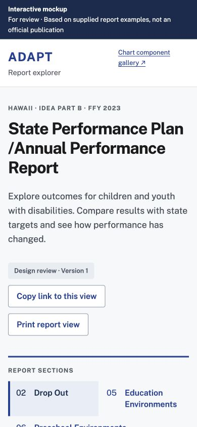

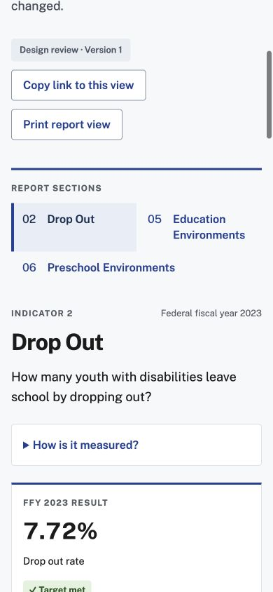

## C2 (checkpoint)
- **Cue:** 06 Preschool Environments link
- **Expectation:** Preschool Environments sounds like the preschool report I need.
- **Action:** Tapped Preschool Environments
- **Result:** The heading changed to Preschool Environments. The result card says 3 measures and 2 targets met · 1 not met.
- **Then:** Now I need to find Measure 6B below.
- **Traits:** ordinary
- **Clicks:** (40.51%, 45.26%)

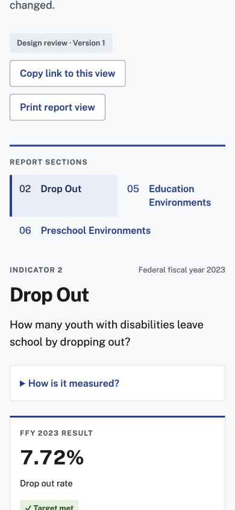

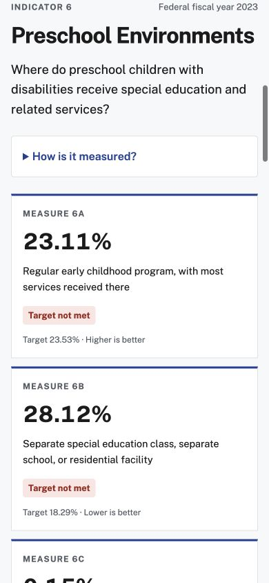

## ? (correction)
- **Corrects:** C2
- **Note:** C2 result was recorded incorrectly. The actual result screenshot shows Preschool Environments with Measure 6A 23.11% Target not met and Measure 6B 28.12% Target not met; it does not show a 3 measures summary.

## C3 (checkpoint)
- **Cue:** Measure 6B card: 28.12%, Target not met; target 18.29%, Lower is better
- **Action:** Scrolled down
- **Result:** Results by measure has Measure 6A selected in blue and a Measure 6B button beside it.
- **Then:** I can tap Measure 6B to get the view I need.
- **Traits:** LIT, HTS
- **Not read:** Preschool question paragraph

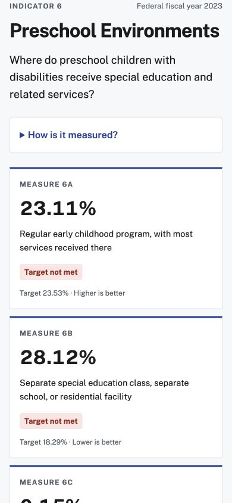

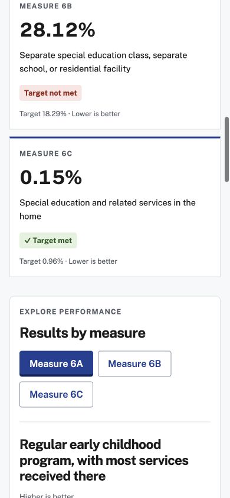

## C4 (checkpoint)
- **Cue:** Measure 6B button beside selected Measure 6A
- **Action:** Tapped Measure 6B
- **Result:** Measure 6B is blue and the heading changes to Separate special education class, separate school, or residential facility.
- **Then:** This is the measure I want to share.
- **Traits:** ordinary
- **Clicks:** (58.21%, 72.99%)

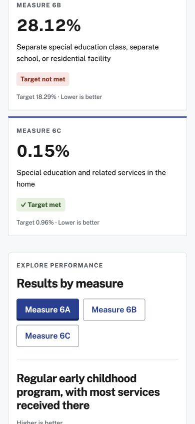

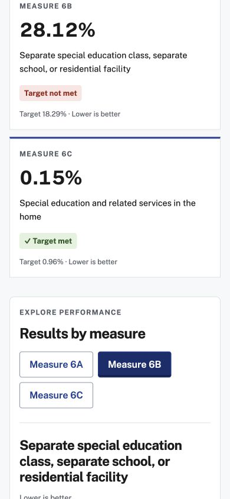

## C5 (checkpoint)
- **Cue:** Selected Measure 6B heading at bottom of screen
- **Action:** Scrolled down
- **Result:** Highlighted result says Target not met; 28.12% actual · 18.29% target. Lower is better appears above it.
- **Then:** Hawaii did not meet this target. I need the link and somewhere to put my note.
- **Traits:** LIT, HTS
- **Not read:** Supporting result explanation and baseline note; Source discrepancy paragraph

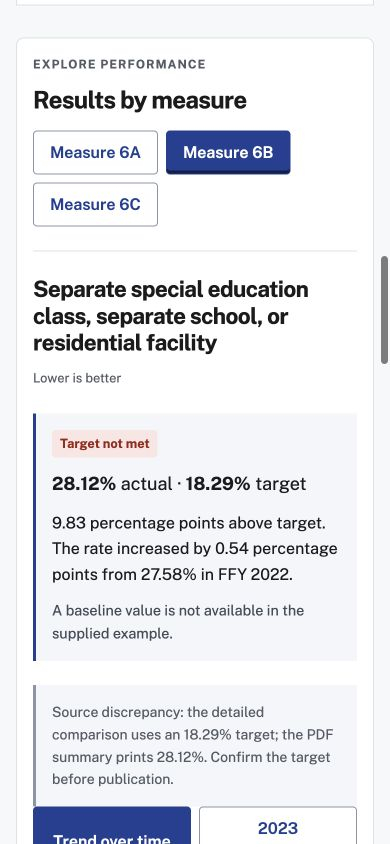

## C6 (checkpoint)
- **Cue:** Copy link was above; currently the 6B result remains visible
- **Action:** Pressed Control+Home
- **Result:** The screen stayed on Measure 6B result.
- **Then:** That did not take me back; I will scroll up.
- **Traits:** ordinary
- **Not read:** Supporting explanation; Source discrepancy

## C7 (checkpoint)
- **Cue:** The 6B result is still on screen
- **Action:** Scrolled up two screens
- **Result:** Copy link to this view button is visible above the selected Preschool Environments section.
- **Then:** This should copy the selected report for my colleague.
- **Traits:** ordinary
- **Not read:** Introductory paragraph

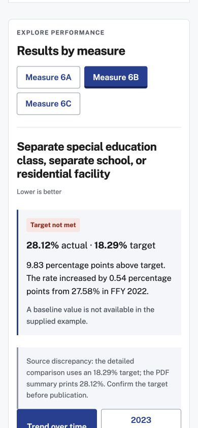

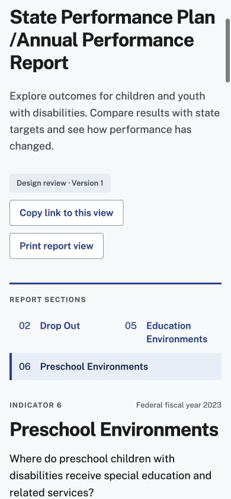

## C8 (checkpoint)
- **Cue:** Copy link to this view button
- **Action:** Tapped Copy link to this view
- **Result:** A line appears: Link copied. It includes the indicator, measure, chart view, and display settings.
- **Then:** The link is ready. I still need a review note.
- **Traits:** LIT
- **Clicks:** (30.0%, 42.65%)
- **Not read:** Introductory paragraph

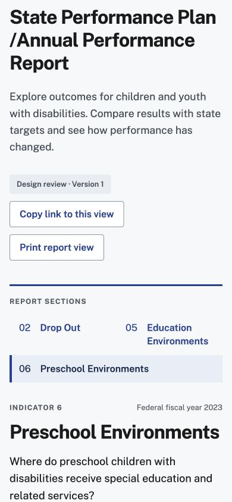

## C9 (checkpoint)
- **Cue:** Report view has no visible note field
- **Action:** Scrolled down four screens
- **Result:** Reached Behind the percentages and Reported population by category, with chart controls.
- **Then:** The notes must be farther down.
- **Traits:** ordinary
- **Not read:** Chart interaction instructions; Reported population explanation

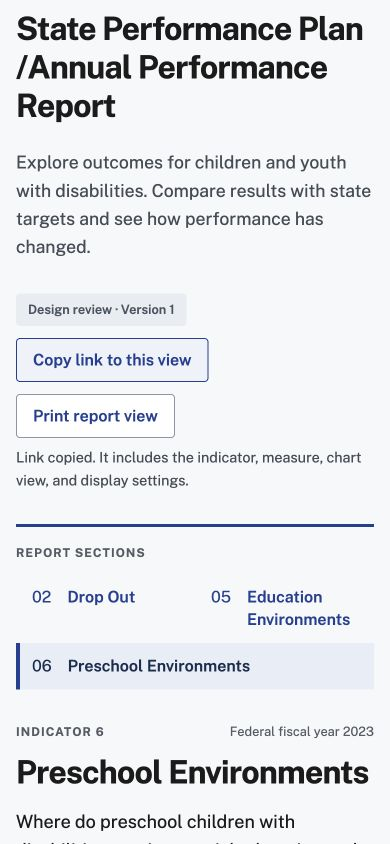

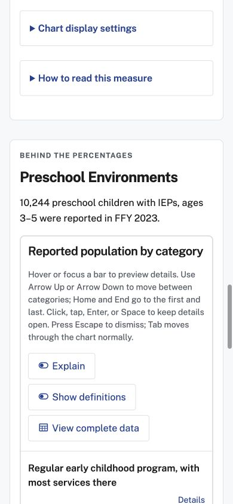

## C10 (checkpoint)
- **Cue:** Still in population chart section
- **Action:** Scrolled down two and a half screens
- **Result:** Review notes for this indicator text box is visible with Save notes in this browser and Download review notes buttons.
- **Then:** I can write my note here, then save it.
- **Traits:** HTS
- **Not read:** Notes stay in this browser and download explanation

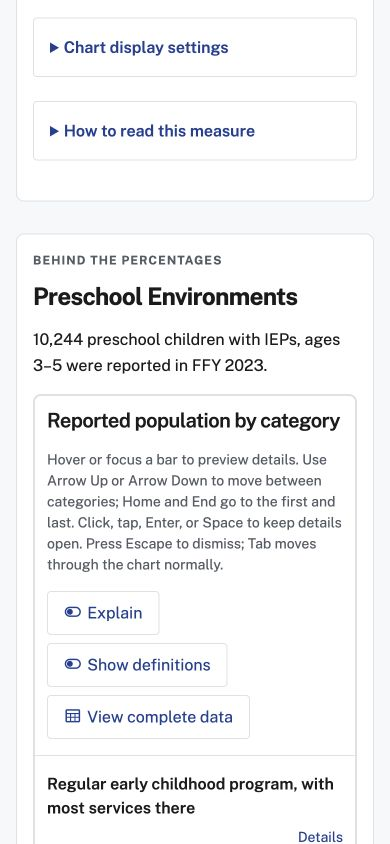

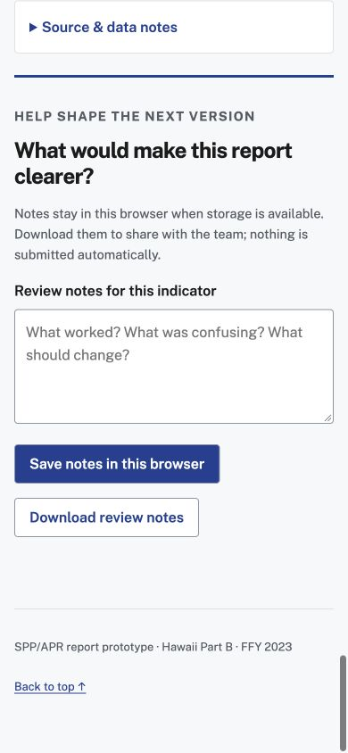

## C11 (checkpoint)
- **Cue:** Review notes for this indicator field; blue Save notes in this browser button
- **Expectation:** I'll write down what I found so my colleague knows which result I mean.
- **Action:** Tapped the note field and typed a note
- **Entered:** Hawaii preschool Measure 6B was 28.12% and did not meet the 18.29% target. Lower is better. Can we talk about what would help this improve?
- **Result:** The full note appears in the text box. Save notes in this browser remains below it.
- **Then:** I would press Save notes in this browser next because it is the blue button beneath my note.
- **Traits:** VPF, HTS
- **Clicks:** (40.26%, 46.45%)
- **Not read:** Notes persistence and sharing explanation

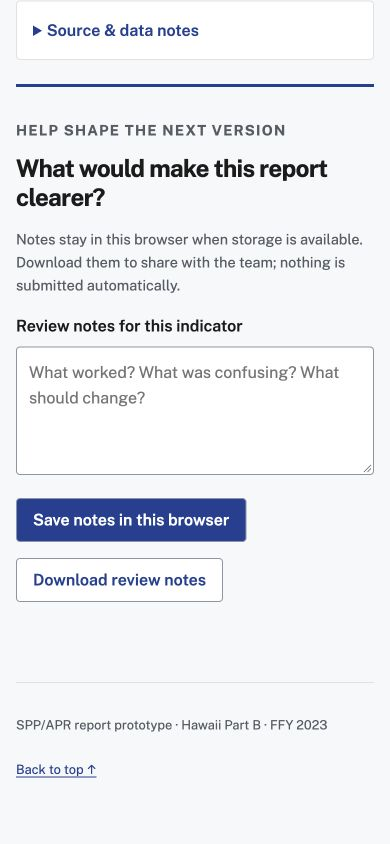

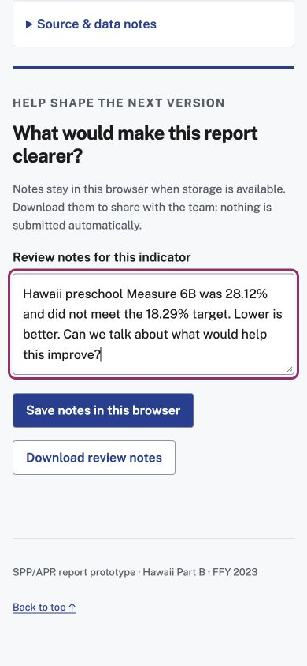

## End
- **Believed:** I found Hawaii preschool Measure 6B. It is 28.12%, did not meet the 18.29% target, and lower is better. The page says the link was copied. My note is typed, but I have not saved or shared it.
- **Cue:** Measure 6B selected; Target not met; Link copied confirmation; visible typed review note and Save notes in this browser button.
- **Stop reason:** permission stop
- **Untested:** Would tap Save notes in this browser at approximately [130,520]. This is a commit point; stopped before it., Would have clicked 0 more times; no unchanged save state was tested.
